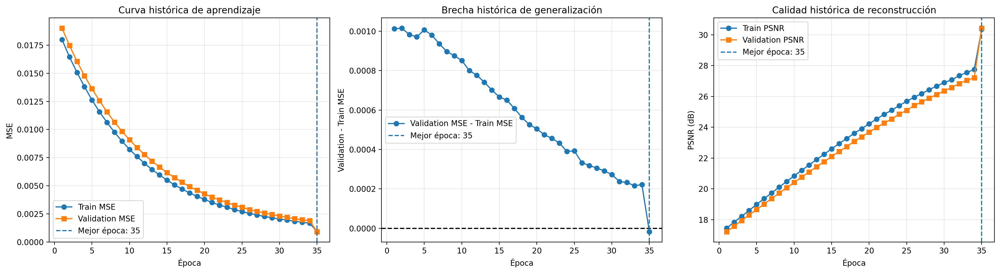
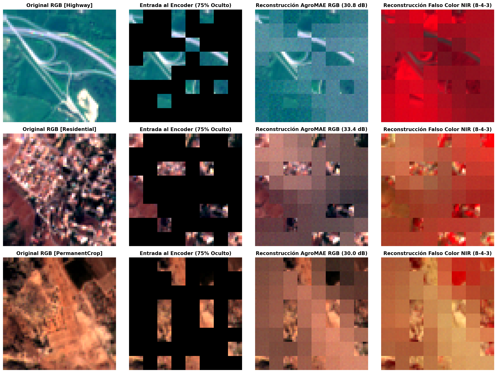
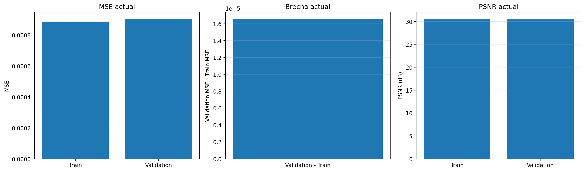

<div align="center">

[](https://colab.research.google.com/github/USUARIO/REPOSITORIO/blob/main/notebooks/AgroMAE_Entrenamiento_Colab.ipynb)

</div>

# AgroMAE
### Aprendizaje autosupervisado para imágenes multiespectrales Sentinel-2

AgroMAE es un proyecto de aprendizaje profundo basado en la arquitectura **Masked Autoencoder (MAE)**. Su objetivo es aprender representaciones espaciales y espectrales de imágenes multiespectrales Sentinel-2 mediante la reconstrucción de regiones enmascaradas.

El modelo se entrena de forma autosupervisada: una parte de la imagen se oculta y el modelo aprende a reconstruir la información faltante a partir de los parches visibles. Este enfoque permite estudiar el potencial de las imágenes satelitales para futuras aplicaciones agrícolas y ambientales.

## Dataset

El proyecto utiliza imágenes multiespectrales Sentinel-2 del conjunto **EuroSAT**. EuroSAT contiene imágenes georreferenciadas de Sentinel-2, organizadas en 10 clases de cobertura y uso del suelo, y dispone de una versión multiespectral con 13 bandas.

- **Dataset:** EuroSAT (versión multiespectral).
- **Sensor:** Sentinel-2.
- **Bandas:** 13.
- **Clases originales:** 10.
- **Total de muestras del conjunto original:** 27.000 imágenes.
- **Fuente oficial:** [EuroSAT en GitHub](https://github.com/phelber/eurosat).
- **Artículo del dataset:** Helber et al. (2019), *EuroSAT: A Novel Dataset and Deep Learning Benchmark for Land Use and Land Cover Classification*.

En este proyecto, las imágenes se preparan para el modelo con una resolución de 64 × 64 píxeles. La distribución usada para entrenamiento y validación corresponde a una partición del conjunto; no es la división original publicada por EuroSAT.

## Objetivo

Implementar y evaluar un modelo MAE para aprender características de imágenes multiespectrales Sentinel-2 mediante reconstrucción de parches enmascarados.

## Arquitectura

AgroMAE utiliza una arquitectura Encoder-Decoder basada en Transformers.

| Característica | Configuración |
|---|---|
| Entrada | Imágenes multiespectrales Sentinel-2 |
| Bandas | 13 |
| Resolución de entrada | 64 × 64 píxeles |
| Tamaño de parche | 8 × 8 píxeles |
| Número de tokens | 64 |
| Proporción de enmascaramiento | 75 % |
| Encoder | 6 bloques Transformer |
| Dimensión del encoder | 256 |
| Decoder | 3 bloques Transformer |
| Dimensión del decoder | 128 |
| Función de pérdida | MSE sobre parches enmascarados |

El encoder aprende representaciones a partir de los parches visibles. Posteriormente, el decoder utiliza estas representaciones para reconstruir los parches ocultos.

## Metodología

1. Obtención y organización del conjunto EuroSAT multiespectral.
2. Procesamiento de imágenes Sentinel-2 para adaptarlas a la entrada del modelo.
3. División de las imágenes en parches.
4. Enmascaramiento aleatorio de una parte de los parches.
5. Entrenamiento autosupervisado mediante reconstrucción.
6. Evaluación con datos de entrenamiento y validación.
7. Generación de visualizaciones para analizar el entrenamiento y las reconstrucciones.

## Resultados y visualizaciones

Las visualizaciones generadas durante el proyecto permiten examinar la evolución del entrenamiento, el comportamiento de la pérdida y las reconstrucciones multiespectrales.

> Las rutas de las imágenes son relativas al repositorio. Coloca los PNG correspondientes en la carpeta `logs/` para que se visualicen en GitHub.

### Curvas de entrenamiento



### Reconstrucción multiespectral



### Diagnóstico del modelo



## Tecnologías

- Python
- PyTorch
- NumPy
- Matplotlib
- Google Colab
- Google Drive
- Transformers
- Sentinel-2 / EuroSAT

## Estructura sugerida del repositorio

```text
AgroMAE/
├── README.md
├── notebooks/
│   └── AgroMAE_Entrenamiento_Colab.ipynb
├── checkpoints/
│   ├── checkpoint_best.pth
│   └── checkpoint_last.pth
└── logs/
    ├── curvas_historicas_reales_agromae.png
    ├── reconstruccion_multiespectral_agromae.png
    ├── diagnostico_real_agromae.png
    └── curva_overfitting_agromae.png
```

La estructura es una propuesta. Ajusta los nombres y las rutas para que coincidan con los archivos que subas realmente.

## Estado del proyecto

El proyecto cuenta con la implementación y entrenamiento del modelo MAE, evaluación mediante pérdida de reconstrucción y generación de visualizaciones. AgroMAE constituye una base experimental para el aprendizaje de representaciones multiespectrales.

## Trabajo futuro

Se propone explorar la integración de AgroMAE con información de suelos de Colombia. Una posible línea de investigación consiste en utilizar las representaciones aprendidas por el encoder como entrada para tareas supervisadas de clasificación o análisis de características del suelo. Esta etapa requerirá datos de referencia, integración geoespacial y evaluación específica.

## Referencias

1. Helber, P., Bischke, B., Dengel, A., & Borth, D. (2019). **EuroSAT: A Novel Dataset and Deep Learning Benchmark for Land Use and Land Cover Classification.** *IEEE Journal of Selected Topics in Applied Earth Observations and Remote Sensing, 12*(7), 2217–2226. https://doi.org/10.1109/JSTARS.2019.2918242  
   Dataset: https://github.com/phelber/eurosat

2. He, K., Chen, X., Xie, S., Li, Y., Dollár, P., & Girshick, R. (2022). **Masked Autoencoders Are Scalable Vision Learners.** *Proceedings of the IEEE/CVF Conference on Computer Vision and Pattern Recognition (CVPR)*, 16000–16009. https://doi.org/10.1109/CVPR52688.2022.01553

## Autor

Proyecto académico de aprendizaje profundo y procesamiento de imágenes multiespectrales.
