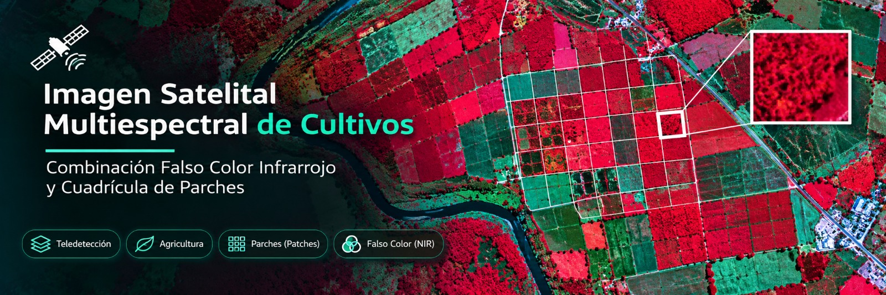
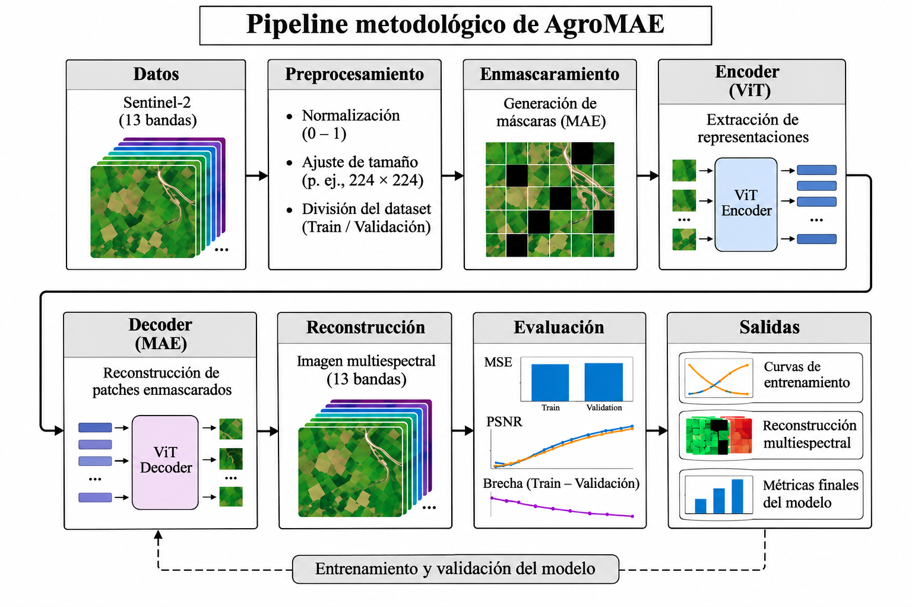
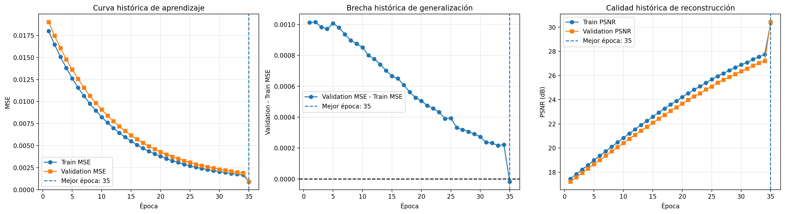
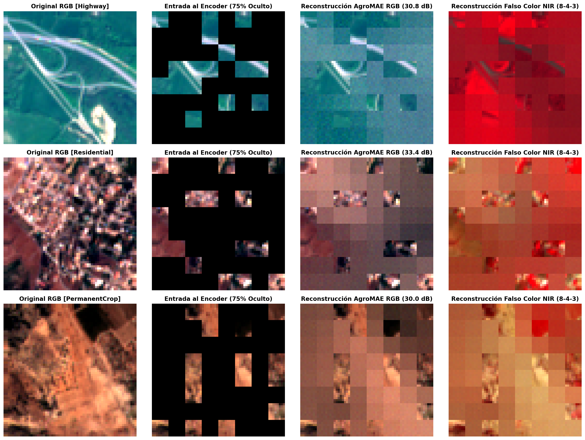
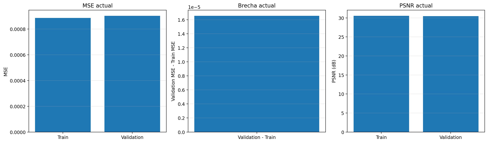

<div align="center">
  
</div>

[](https://colab.research.google.com/github/USUARIO/REPOSITORIO/blob/main/notebooks/AgroMAE_Entrenamiento_Colab.ipynb)

</div>

# AgroMAE
### Aprendizaje autosupervisado para imágenes multiespectrales Sentinel-2

AgroMAE es un proyecto de aprendizaje profundo basado en la arquitectura **Masked Autoencoder (MAE)**. Su objetivo es aprender representaciones espaciales y espectrales de imágenes multiespectrales Sentinel-2 mediante la reconstrucción de regiones enmascaradas.

El modelo se entrena de forma autosupervisada: una parte de la imagen se oculta y el modelo aprende a reconstruir la información faltante a partir de los parches visibles. Este enfoque permite estudiar el potencial de las imágenes satelitales para futuras aplicaciones agrícolas y ambientales.

## Dataset

El proyecto utiliza imágenes multiespectrales Sentinel-2 del conjunto **EuroSAT**. EuroSAT contiene imágenes georreferenciadas de Sentinel-2, organizadas en 10 clases de cobertura y uso del suelo, y dispone de una versión multiespectral con 13 bandas.

- **Dataset:** EuroSAT (versión multiespectral).
- **Sensor:** Sentinel-2.
- **Bandas:** 13.
- **Clases originales:** 10.
- **Total de muestras del conjunto original:** 27.000 imágenes.
- **Fuente oficial:** [EuroSAT en GitHub](https://github.com/phelber/eurosat).
- **Artículo del dataset:** Helber et al. (2019), *EuroSAT: A Novel Dataset and Deep Learning Benchmark for Land Use and Land Cover Classification*.

En este proyecto, las imágenes se preparan para el modelo con una resolución de 64 × 64 píxeles. La distribución usada para entrenamiento y validación corresponde a una partición del conjunto; no es la división original publicada por EuroSAT.

## Objetivo

Implementar y evaluar un modelo MAE para aprender características de imágenes multiespectrales Sentinel-2 mediante reconstrucción de parches enmascarados.

## Arquitectura

AgroMAE utiliza una arquitectura Encoder-Decoder basada en Transformers.

| Característica | Configuración |
|---|---|
| Entrada | Imágenes multiespectrales Sentinel-2 |
| Bandas | 13 |
| Resolución de entrada | 64 × 64 píxeles |
| Tamaño de parche | 8 × 8 píxeles |
| Número de tokens | 64 |
| Proporción de enmascaramiento | 75 % |
| Encoder | 6 bloques Transformer |
| Dimensión del encoder | 256 |
| Decoder | 3 bloques Transformer |
| Dimensión del decoder | 128 |
| Función de pérdida | MSE sobre parches enmascarados |

El encoder aprende representaciones a partir de los parches visibles. Posteriormente, el decoder utiliza estas representaciones para reconstruir los parches ocultos.

## Pipeline metodológico

El siguiente pipeline representa el flujo de procesamiento de AgroMAE, desde la entrada de imágenes Sentinel-2 hasta la reconstrucción multiespectral y la evaluación del modelo.



## Metodología

1. Obtención y organización del conjunto EuroSAT multiespectral.
2. Procesamiento de imágenes Sentinel-2 para adaptarlas a la entrada del modelo.
3. División de las imágenes en parches.
4. Enmascaramiento aleatorio de una parte de los parches.
5. Entrenamiento autosupervisado mediante reconstrucción.
6. Evaluación con datos de entrenamiento y validación.
7. Generación de visualizaciones para analizar el entrenamiento y las reconstrucciones.

## Resultados y visualizaciones

Las visualizaciones generadas durante el proyecto permiten examinar la evolución del entrenamiento, el comportamiento de la pérdida y las reconstrucciones multiespectrales.

> Las rutas de las imágenes son relativas al repositorio. Coloca los PNG correspondientes en la carpeta `logs/` para que se visualicen en GitHub.


### Curvas de entrenamiento



### Reconstrucción multiespectral



### Evaluación final del modelo


## Tecnologías

- Python
- PyTorch
- NumPy
- Matplotlib
- Google Colab
- Google Drive
- Transformers
- Sentinel-2 / EuroSAT

## Estructura 

```text
AgroMAE/
├── README.md
├── notebooks/
│   └── AgroMAE_Entrenamiento_Colab.ipynb
├── checkpoints/
│   ├── checkpoint_best.pth
│   └── checkpoint_last.pth
└── logs/
    ├── curvas_historicas_reales_agromae.png
    ├── reconstruccion_multiespectral_agromae.png
    ├── diagnostico_real_agromae.png
    └── curva_overfitting_agromae.png
```

La estructura es una propuesta. Ajusta los nombres y las rutas para que coincidan con los archivos que subas realmente.

## Estado del proyecto

El proyecto cuenta con la implementación y entrenamiento del modelo MAE, evaluación mediante pérdida de reconstrucción y generación de visualizaciones. AgroMAE constituye una base experimental para el aprendizaje de representaciones multiespectrales.

## Trabajo futuro

Se propone explorar la integración de AgroMAE con información de suelos de Colombia. Una posible línea de investigación consiste en utilizar las representaciones aprendidas por el encoder como entrada para tareas supervisadas de clasificación o análisis de características del suelo. Esta etapa requerirá datos de referencia, integración geoespacial y evaluación específica.

## Referencias

1. Helber, P., Bischke, B., Dengel, A., & Borth, D. (2019). **EuroSAT: A Novel Dataset and Deep Learning Benchmark for Land Use and Land Cover Classification.** *IEEE Journal of Selected Topics in Applied Earth Observations and Remote Sensing, 12*(7), 2217–2226. https://doi.org/10.1109/JSTARS.2019.2918242  
   Dataset: https://github.com/phelber/eurosat

2. He, K., Chen, X., Xie, S., Li, Y., Dollár, P., & Girshick, R. (2022). **Masked Autoencoders Are Scalable Vision Learners.** *Proceedings of the IEEE/CVF Conference on Computer Vision and Pattern Recognition (CVPR)*, 16000–16009. https://doi.org/10.1109/CVPR52688.2022.01553

## Autor

Proyecto académico de aprendizaje profundo y procesamiento de imágenes multiespectrales.

## Presentaciones
* **Entrega 1 y 2 (Canva):** [docs/Entrega_1_y_2.pdf](docs/Entrega_1_y_2.pdf)
* **Entrega Final (Google Slides):** [entrega final/AgroMAE_Entrega_Final.pdf](entrega%20final/AgroMAE_Entrega_Final.pdf)

---

# 🚀 Actualización — Tercera Entrega (Entrega Final)

[](https://colab.research.google.com/github/Afav22-lab/AgroMAE-Project/blob/main/AgroMAE_Entrenamiento_Colab.ipynb)

En esta fase final se amplió [AgroMAE_Entrenamiento_Colab.ipynb](AgroMAE_Entrenamiento_Colab.ipynb) agregando las **Secciones 8 a 13** sin alterar el trabajo previo de la Segunda Entrega. El objetivo es evaluar integralmente las representaciones auto-supervisadas del *Encoder* frente a arquitecturas **MLP** y **CNN**, analizar la contribución física de las 13 bandas y validar el modelo sobre escenas satelitales reales de **Colombia y el resto del mundo**.

## Qué se agregó en la Tercera Entrega

### 1. Arquitecturas Clasificadoras Downstream (`MLP` vs. `CNN`) y Aceleración en RAM (Sección 8)
* **Reutilización directa de checkpoints + Caché en RAM:** Carga `checkpoint_best.pth` de Fase 1 desde Google Drive, pre-carga los 27,000 cubos multiespectrales en RAM (`uint16`) cuando hay memoria disponible y guarda el progreso incremental en `logs/entrega3_resultados.json`.
* **Comparativa de 3 clasificadores sobre 13 bandas Sentinel-2:**
  * `ResNet18MultiSpectral`: Red convolucional residual (**CNN Baseline desde cero**) adaptada a entradas `64×64×13`.
  * `AgroMAEClassifierMLP`: Encoder ViT pre-entrenado + *Global Average Pooling* + **Cabezal MLP** de 2 capas.
  * `AgroMAEClassifierCNN`: Encoder ViT pre-entrenado cuyos 64 tokens latentes se reorganizan a su grilla espacial 2D `(B, 256, 8, 8)` y pasan por un **Cabezal CNN Espacial 2D residual** para capturar bordes geométricos de ríos, vías y parcelas.

### 2. Curva Completa de Escasez de Etiquetas (Sección 9)
* Evaluación estratificada bajo **6 regímenes de disponibilidad de etiquetas**: **`1%`, `5%`, `10%`, `25%`, `50%` y `100%`**.
* Compara cara a cara `ResNet-18 (CNN 13ch)`, `ViT + MLP (Scratch)`, `AgroMAE + MLP (Fine-Tuning)` y `AgroMAE + CNN Espacial (Fine-Tuning)`, además de contrastar **Linear Probing** (*Encoder* congelado) frente a **Fine-Tuning Completo** en `10%` y `100%`.

### 3. Estudio de Ablación del Porcentaje de Enmascaramiento (Sección 10)
* Compara de forma controlada tasas de ocultación `mask_ratio` de **`50%` vs. `75%` vs. `85%`** midiendo calidad de reconstrucción (`Val MSE`, `Val PSNR`), costo computacional por época y transferencia con el `10%` de etiquetas.

### 4. Diagnóstico por Clase e Importancia de las 13 Bandas Sentinel-2 (Sección 11)
* **Matriz de Confusión Normalizada (%)** y reporte detallado (`Precision`, `Recall`, `F1-Score`) sobre las **4,050 imágenes de validación** con el modelo campeón al `100%`.
* **Importancia Espectral por Permutación:** Evalúa la caída de exactitud al permutar cada banda individual, demostrando cuantitativamente el aporte del **Red-Edge (`B05–B07`)**, **Infrarrojo Cercano (`B08`/`B8A`)** y **SWIR (`B11`/`B12`)** frente al espectro visible RGB.

### 5. Verificación Geoespacial Global — *"¿Qué es este lugar?"* (Secciones 12 y 13)
* **Motor STAC sin credenciales:** Conecta con **Element 84 Earth Search (`sentinel-2-c1-l2a`)** y **Microsoft Planetary Computer (`sentinel-2-l2a`)** para descargar ventanas reales de $640\text{ m}\times 640\text{ m}$ (`64×64` px) libres de nubes (filtro automático con máscara `SCL`), aplicando calibración radiométrica `Baseline 04.00+` y alineamiento Rayleigh L2A$\\rightarrow$TOA.
* **Lugares evaluados en Colombia 🇨🇴 y el Mundo 🌍:**
  * 🇨🇴 Amazonia (Tarapacá, Amazonas), Valle del Cauca (Palmira), Bucaramanga (Santander) y Lago de Tota (Boyacá).
  * 🌍 Central Valley (California, EE. UU.), Olivares de Jaén (España), Puerto de Róterdam (Países Bajos) y Tokio Urbano (Japón).
* **Diagnóstico completo por coordenada:** Muestra reconstrucción MAE al 75% (`PSNR dB` + RGB + Falso Color NIR `8-4-3`), predicción Top-3 con consenso entre `AgroMAE-CNN`, `AgroMAE-MLP` y `ResNet-18`, y verificación física mediante **`NDVI`**, **`NDWI`** y **`NDBI`**.
* **Laboratorio Interactivo (`Sección 13`):** Formulario `@param` en Colab para consultar cualquier par `(LATITUD, LONGITUD)` del planeta en tiempo real.

## Tecnologías y librerías añadidas
* `pystac-client` y `planetary-computer` (consulta STAC abierta de Sentinel-2)
* `pyproj` y `rasterio` (reproyección UTM y recorte geográfico de ventanas `640×640 m`)
* `scikit-learn` (partición estratificada, métricas macro y matrices de confusión)

## Gráficas generadas en `logs/` al ejecutar la Tercera Entrega
* `logs/entrega3_curva_escasez_completa.png` — Curva `1% → 100%` (`Accuracy` y `F1-Macro`).
* `logs/entrega3_ablacion_mask_ratio.png` — Ablación `50%` vs. `75%` vs. `85%`.
* `logs/entrega3_matriz_confusion_y_f1.png` — Matriz de confusión al `100%` y F1 por clase.
* `logs/entrega3_importancia_13_bandas.png` — Aporte de cada banda espectral de Sentinel-2.

## Cómo ejecutar rápidamente la Tercera Entrega en Colab
1. Abre [`AgroMAE_Entrenamiento_Colab.ipynb`](https://colab.research.google.com/github/Afav22-lab/AgroMAE-Project/blob/main/AgroMAE_Entrenamiento_Colab.ipynb) en Google Colab con **GPU L4** (o T4) y **RAM amplia**.
2. Ejecuta únicamente las **Secciones 1, 2, 3 y 4** *(montar Google Drive, cargar EuroSAT e instanciar `AgroMAE`)*.
3. Salta el bucle de entrenamiento de la Sección 5 y ejecuta directamente las **Secciones 8 a 13**, que cargan automáticamente tu `checkpoint_best.pth` guardado en Drive.
