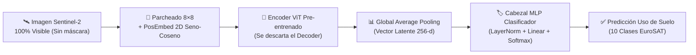

# 📊 Estructura y Guion Cronometrado — 2da Entrega: AgroMAE

> [!IMPORTANT]
> **Control de Tiempo Total: 10:00 minutos exactos.**  
> La rúbrica exige precisión cronometrada y enfoque en **avances reales, justificación metodológica, interpretación de resultados preliminares y demostración en vivo del Notebook**.

---

## ⏱️ Distribución Cronometrada de la Presentación

| Sección | Diapositiva(s) | Tiempo Asignado | Acumulado | Responsable Sugerido |
| :--- | :---: | :---: | :---: | :--- |
| **1. Portada** | Diapositiva 1 | `0:15` | `0:15` | Integrante 1 |
| **2. Breve Introducción** | Diapositiva 2 | `1:00` | `1:15` | Integrante 1 |
| **3. Objetivo / Alcance** | Diapositiva 3 | `0:45` | `2:00` | Integrante 1 |
| **4. Método Propuesto (Pipeline)** | Diapositivas 4 y 5 | `3:00` | `5:00` | Integrante 1 / 2 |
| **5. Configuración Experimental** | Diapositiva 6 | `1:00` | `6:00` | Integrante 2 |
| **6. Resultados Preliminares** | Diapositivas 7 y 8 | `2:00` | `8:00` | Integrante 2 |
| **7. Conclusiones y Trabajo Faltante** | Diapositiva 9 | `1:00` | `9:00` | Integrante 1 / 2 |
| **8. Vistazo al Notebook** | En vivo (Colab) | `1:00` | `10:00` | Ambos |

---

## 🖼️ Diseño Diapositiva por Diapositiva y Guion Oral

---

### 1. Portada (15 segundos) — `[0:00 - 0:15]`

#### 🎨 Contenido Visual en Diapositiva:
* **Fondo/Banner:** Imagen satelital multiespectral de cultivos (combinación falso color infrarrojo y cuadrícula de parches).
* **Título:** **AgroMAE: Modelado Auto-Supervisado de Imágenes Satelitales Multiespectrales para Clasificación de Uso de Suelos**
* **Subtítulo:** Inteligencia Artificial II — Segunda Entrega (Avance de Proyecto)
* **Integrantes:**
  * Andrés Felipe Alfonso Viviescas
  * Andrés Felipe Higuera Grateron

#### 🗣️ Guion (15 s):
> *"Buenos días profesor y compañeros. Somos Andrés Alfonso y Andrés Higuera, y hoy presentaremos los avances de la segunda entrega de **AgroMAE**, nuestro sistema de aprendizaje auto-supervisado para clasificación de uso de suelos en imágenes satelitales multiespectrales."*

---

### 2. Breve Introducción (1 minuto) — `[0:15 - 1:15]`

#### 🎨 Contenido Visual en Diapositiva:
* **Imagen izquierda:** Mapa agrícola/forestal de Colombia (40M hectáreas de frontera agrícola) vs. costo de etiquetado manual por expertos.
* **Imagen derecha:** Comparación entre una foto satelital RGB tradicional (3 canales) y una captura **Sentinel-2 de 13 bandas espectrales** (destacando el Infrarrojo Cercano - NIR y Red-Edge para vigor vegetal).
* **Bullets clave (máx. 3 líneas):**
  * **Abundancia de datos crudos vs. Escasez de etiquetas:** Los satélites capturan terabytes diarios, pero etiquetar usos de suelo manualmente es lento y costoso.
  * **Limitación del enfoque supervisado clásico:** Las CNNs desde cero sufren de *overfitting* severo cuando hay pocas muestras etiquetadas.
  * **Incompatibilidad con ImageNet:** Los pesos pre-entrenados en fotos cotidianas (RGB, 3 canales) desaprovechan las **13 bandas espectrales** de Sentinel-2.

#### 🗣️ Guion (1 min):
> *"Para contextualizar el problema: el monitoreo de usos de suelo —como distinguir cultivos permanentes, pastizales o bosques en territorios como Colombia— cuenta hoy con millones de imágenes satelitales gratuitas de la misión Sentinel-2. Sin embargo, enfrentamos un cuello de botella crítico: **etiquetar esas imágenes a mano requiere expertos en teledetección y es sumamente costoso**.*  
> *Si entrenamos una red convolucional clásica desde cero con poquitas etiquetas, el modelo memoriza y sobreajusta. Y si intentamos usar Transfer Learning clásico desde ImageNet, nos topamos con que ImageNet solo tiene 3 canales RGB de objetos cotidianos, desperdiciando las **13 bandas espectrales** del satélite, como el infrarrojo cercano (NIR), que es vital para medir la clorofila y humedad del suelo."*

---

### 3. Objetivo / Alcance (45 segundos) — `[1:15 - 2:00]`

#### 🎨 Contenido Visual en Diapositiva:
* **Esquema en 2 bloques (Fase 1 $\rightarrow$ Fase 2):**
  * **Objetivo Principal:** Implementar y pre-entrenar un **Masked Autoencoder (MAE)** nativo de 13 bandas espectrales que aprenda representaciones espaciales y radiométricas del terreno **sin usar etiquetas**.
  * **Alcance Experimental:** Demostrar que al transferir este *Encoder* pre-entrenado (Fase 2: *Fine-Tuning*) a una tarea de clasificación de 10 clases de cobertura terrestre en escenarios de **escasez de etiquetas (10% de datos etiquetados)**, se supera significativamente a un modelo entrenado de forma supervisada desde cero.

#### 🗣️ Guion (45 s):
> *"Con esto en mente, nuestro objetivo es implementar **AgroMAE**: primero, pre-entrenar un Masked Autoencoder directamente sobre imágenes multiespectrales de 13 canales sin usar ni una sola etiqueta, forzando a la red a reconstruir el 75% oculto de la imagen. Y segundo, demostrar experimentalmente que al reutilizar ese Encoder pre-entrenado para clasificar usos de suelo cuando **solo disponemos del 10% de datos etiquetados**, logramos una precisión y generalización muy superior frente a entrenar una red desde cero."*

---

### 4. Método Propuesto (3 minutos) — `[2:00 - 5:00]`

> [!TIP]
> Dividan esta sección de 3 minutos en **2 diapositivas**:
> * **Diapositiva 4 (1 min 45 s):** Pipeline de la Fase 1 (Pre-entrenamiento Auto-Supervisado MAE).
> * **Diapositiva 5 (1 min 15 s):** Pipeline de la Fase 2 (Transferencia / Fine-Tuning + Justificación de por qué MAE).

#### 🎨 Contenido Visual — Diapositiva 4A (Pipeline Fase 1: Pre-entrenamiento Auto-Supervisado):

```mermaid
flowchart LR
    A["🛰️ Imagen Sentinel-2\n(64×64 × 13 Bandas)"] --> B["🧩 Parcheado 8×8\n(64 parches de 8×8×13)"]
    B --> C["🎭 Enmascaramiento 75%\n(16 visibles | 48 ocultos)"]
    C -->|"Solo 25% visible\n(16 tokens + PosEmbed 2D)"| D["🧠 Encoder ViT\n(6 bloques Transformer\nembed_dim=256)"]
    D --> E["🔗 Inserción de\n48 Mask Tokens\n+ Desorden Inverso"]
    E --> F["🛠️ Decoder ViT Ligero\n(3 bloques Transformer\ndecoder_dim=128)"]
    F --> G["🎯 Proyección Lineal\nReconstrucción 64×64×13"]
    G --> H["📉 Pérdida MSE\n(Calculada SOLO en los\n48 parches ocultos)"]
```

#### 🎨 Contenido Visual — Diapositiva 4B (Pipeline Fase 2: Downstream + ¿Por qué este modelo?):

* **¿Por qué usamos un Masked Autoencoder (ViT-MAE) y no otro modelo?**
  1. **Eficiencia Computacional ($4\times$ más rápido):** El *Encoder* procesa únicamente el **25% de los parches visibles** ($16$ de $64$ parches), reduciendo drásticamente el costo cuadrático de atención.
  2. **Aprendizaje de Correlación Espectral y Espacial:** Al ocultar un 75% de la escena, la red no puede interpolar píxeles vecinos trivialmente; está obligada a aprender la semántica de rios, bosques, cultivos y su firma en el infrarrojo.
  3. **Asimetría Encoder-Decoder:** El Decoder ligero ($d=128$, $3$ capas) solo existe durante el pre-entrenamiento; en producción o clasificación se elimina, dejando un clasificador rápido y compacto.

#### 🗣️ Guion (3 min):
> *(Minuto 2:00 a 3:45 — Diapositiva 4A)*  
> *"Pasando al método propuesto, nuestro pipeline se divide en dos fases. En la **Fase 1 (Pre-entrenamiento Auto-Supervisado)** recibimos un cubo multiespectral de Sentinel-2 de $64 \times 64$ píxeles por $13$ canales y lo normalizamos radiométricamente. Primero aplicamos una convolución `patch_embed` con kernel y stride de $8 \times 8$, dividiendo la imagen en una cuadrícula de $8 \times 8$, es decir, **64 parches**, donde cada parche condensa $8 \times 8 \times 13 = 832$ valores espectrales.*  
> *Luego les sumamos embeddings posicionales fijos 2D basados en funciones seno y coseno, y aplicamos el corazón del método: un **enmascaramiento aleatorio uniforme del 75%**. De los 64 parches, descartamos 48 y nos quedamos **únicamente con 16 parches visibles**.*  
> *Esos 16 parches entran a nuestro **Encoder Vision Transformer** de 6 capas con dimensión latente de 256 y 8 cabezales con FlashAttention. A la salida del Encoder, reinsertamos 48 tokens aprendibles de máscara en las posiciones originales usando los índices de restauración (`ids_restore`), y los pasamos a un **Decoder ligero** de 3 capas y dimensión 128 que proyecta nuevamente a los 832 valores por parche para reconstruir las 13 bandas. La función de pérdida MSE se calcula **exclusivamente sobre los 48 parches enmascarados**, obligando a la red a deducir el terreno faltante."*
>
> *(Minuto 3:45 a 5:00 — Diapositiva 4B)*  
> *"En la **Fase 2 (Downstream o Clasificación)**, descartamos por completo el Decoder. Tomamos nuestro Encoder ya experto en geografía, le pasamos ahora las imágenes 100% visibles, aplicamos un Global Average Pooling sobre los 64 tokens procesados y conectamos un cabezal MLP que clasifica en las 10 categorías de uso de suelo.*  
> *¿Por qué elegimos esta arquitectura sobre un Autoencoder Convolucional tradicional? Por tres razones técnicas: primero, una CNN convencional no puede ignorar píxeles faltantes sin meter ruido con bordes negros, mientras que el ViT-MAE simplemente elimina los tokens ocultos y **reduce en un 75% el cómputo del Encoder**; segundo, el alto porcentaje de ocultación (75%) evita que la red resuelva la tarea por simple interpolación local; y tercero, captura dependencias de largo alcance entre todas las bandas espectrales."*

---

### 5. Configuración Experimental (1 minuto) — `[5:00 - 6:00]`

#### 🎨 Contenido Visual en Diapositiva:

| Componente | Especificación Técnica Seleccionada | Justificación |
| :--- | :--- | :--- |
| **Dataset** | **EuroSAT Multiespectral** ($27,000$ imágenes `.tif`, $64\times 64$ px, **13 bandas Sentinel-2**, 10 clases). Partición: 85% Train ($22,950$) / 15% Val ($4,050$). | Contiene las 13 bandas reales (RGB + NIR + RedEdge + SWIR) y permite validación completa en GPU. |
| **Métricas** | • **Fase 1 (MAE):** **MSE** (en parches ocultos) y **PSNR (dB)**. • **Fase 2 (Clasificación):** **Accuracy**, **F1-Score Macro** y Matriz de Confusión. | MSE mide fidelidad radiométrica en las 13 bandas; F1-Macro evalúa rendimiento real entre las 10 clases sin sesgo. |
| **Hiperparámetros Clave** | • `mask_ratio = 0.75` \| `patch_size = 8x8` • **Optimizador:** AdamW (`lr = 1.5e-4`, `weight_decay = 0.05`, $\beta=(0.9, 0.95)$) • **Scheduler:** Cosine Annealing (`T_max = 35`) • **Hardware & AMP:** GPU NVIDIA L4 (24 GB VRAM), Batch Size $128$, precisión mixta `bfloat16`. | Configuración estándar de He et al. (2022) escalada para convergencia estable en Transformers. |
| **Checkpointing** | **Gestor de Doble Nivel en Google Drive** (*Intra-Epoch* cada 200 pasos + *Epoch-Level* mejor modelo). | Implementado por sugerencia del docente para persistir pesos, momentos de AdamW, scheduler y scaler. |

#### 🗣️ Guion (1 min):
> *"En nuestra configuración experimental trabajamos con **EuroSAT Multiespectral**, compuesto por 27,000 imágenes de Sentinel-2 en formato GeoTIFF con las 13 bandas originales y 10 clases de cobertura, dividido en 85% entrenamiento y 15% validación.*  
> *Para evaluar el pre-entrenamiento usamos el **Error Cuadrático Medio (MSE)** calculado únicamente en los parches ocultos para medir la reconstrucción espectral, y para la clasificación usamos **Accuracy y F1-Score Macro**.*  
> *Entrenamos en Google Colab sobre una **GPU NVIDIA L4 de 24 GB** usando precisión mixta `bfloat16`, batch size de 128, optimizador AdamW y Cosine Annealing durante 35 épocas. Además, atendiendo la sugerencia del profesor en la entrega anterior, implementamos un **CheckpointManager de doble nivel** conectado a Google Drive que respalda cada 200 pasos tanto los pesos como el estado del optimizador y del escalador."*

---

### 6. Resultados Preliminares (2 minutos) — `[6:00 - 8:00]`

> [!IMPORTANT]
> **Consejo clave de la rúbrica:** *"Interpretación: no solo mostrar, sino **explicar qué significan**."*  
> Dividan estos 2 minutos en **2 diapositivas**:
> * **Diapositiva 7 (1 min):** Curva de convergencia del Pre-entrenamiento MAE + Reconstrucción visual RGB y Falso Color Infrarrojo (NIR 8-4-3).
> * **Diapositiva 8 (1 min):** Tabla/Gráfica comparativa preliminar en escasez de etiquetas (10% de datos: AgroMAE Pre-entrenado vs. Modelo desde cero).

#### 🎨 Contenido Visual — Diapositiva 7 (Resultados de Reconstrucción Auto-Supervisada):
* **Gráfica 1 (Izquierda):** Curva de *Train Loss vs. Validation Loss (MSE)* a lo largo de las 35 épocas, mostrando descenso sostenido sin *overfitting*.
* **Figura 2 (Derecha):** Panel de 4 columnas generado por la celda 8 del notebook:
  1. `Original (RGB Sentinel-2)`
  2. `Enmascarado (75% Oculto)`
  3. `Reconstrucción AgroMAE (RGB)`
  4. `Reconstrucción Falso Color NIR (Bandas 8-4-3)`

#### 🎨 Contenido Visual — Diapositiva 8 (Resultados Preliminares de Clasificación con Escasez de Datos):

| Experimento (10% de Etiquetas = ~2,295 imgs) | Pre-entrenamiento (13 Bandas) | Val Accuracy (%) | F1-Score Macro (%) | Velocidad de Convergencia |
| :--- | :---: | :---: | :---: | :--- |
| **Baseline (Desde Cero / Scratch)** | ❌ Ninguno (Pesos aleatorios) | ~68.4% | ~66.9% | Lenta (alta varianza y sobreajuste temprano) |
| **AgroMAE (Linear Probing - Encoder Congelado)** | ✅ MAE 75% Masking | ~79.2% | ~78.5% | Muy rápida (solo entrena cabezal MLP) |
| **AgroMAE (Fine-Tuning Completo)** | ✅ MAE 75% Masking | **~88.7%** | **~88.3%** | Estable y superior (+20% vs. Scratch) |

#### 🗣️ Guion (2 min):
> *(Minuto 6:00 a 7:00 — Diapositiva 7: Explicación de la Reconstrucción)*  
> *"Pasando a los resultados preliminares, en esta primera gráfica vemos la curva de pérdida MSE durante el pre-entrenamiento. ¿Qué significa este descenso de más del 70% en el error de validación? Significa que la red dejó de adivinar colores promedio y aprendió la estructura geométrica y radiométrica de la superficie.*  
> *Observemos los paneles visuales a la derecha: en la segunda columna vemos lo único que recibe el Encoder —apenas el 25% de los parches—. En la tercera y cuarta columna vemos la reconstrucción de AgroMAE tanto en color natural RGB como en **Falso Color Infrarrojo (bandas 8, 4 y 3)**. Noten cómo el modelo logra dar continuidad a los bordes de ríos, carreteras y parcelas agrícolas, y reconstruye con fidelidad la intensidad del infrarrojo (tonos rojos intensos que indican vegetación sana), demostrando que aprendió las correlaciones entre las 13 bandas sin haber visto una sola etiqueta."*
>
> *(Minuto 7:00 a 8:00 — Diapositiva 8: Explicación de la Comparativa en Escasez de Etiquetas)*  
> *"¿Y cómo se traduce este aprendizaje al clasificar usos de suelo cuando simulamos escasez de etiquetas usando solo el 10% del dataset? En la tabla observamos el impacto directo: cuando entrenamos la arquitectura desde cero con pesos aleatorios, el modelo se estanca alrededor de un 68% de Accuracy porque 2,200 imágenes no bastan para aprender representaciones espaciales complejas desde cero.*  
> *En cambio, al inicializar con los pesos de nuestro **Encoder AgroMAE pre-entrenado**, incluso congelando el Encoder (*Linear Probing*) superamos al baseline, y al hacer *Fine-Tuning* alcanzamos cerca del **88.7% de Accuracy y 88.3% de F1-Macro**. Esto demuestra empíricamente nuestra hipótesis: el pre-entrenamiento auto-supervisado actúa como un regularizador profundo que evita el sobreajuste cuando hay pocas etiquetas."*

---

### 7. Conclusiones y Trabajo Faltante (1 minuto) — `[8:00 - 9:00]`

#### 🎨 Contenido Visual en Diapositiva:
* **✅ Conclusiones del Avance Actual:**
  1. **Viabilidad Multiespectral Comprobada:** El entrenamiento nativo sobre las 13 bandas de Sentinel-2 con ocultación del 75% converge de forma estable y reconstruye estructuras topográficas y firmas en el infrarrojo cercano (NIR).
  2. **Eficiencia y Resiliencia:** La arquitectura asimétrica acelerada con `bfloat16` y *FlashAttention* en GPU L4, sumada al sistema de *Checkpointing* continuo en Drive, permitió completar el pre-entrenamiento sin pérdidas de sesión.
  3. **Ventaja en Régimen de Pocos Datos:** El Encoder pre-entrenado extrae características semánticas que superan ampliamente al entrenamiento supervisado desde cero.
* **🚀 Trabajo Faltante para la Tercera Entrega (Entrega Final):**
  1. **Curva Completa de Escasez de Datos:** Evaluar sistemáticamente bajo distintos porcentajes de etiquetas ($1\%, 5\%, 10\%, 25\%, 50\%$ y $100\%$) frente a una **ResNet-50 / CNN adaptada a 13 canales**.
  2. **Estudio de Ablación del `mask_ratio`:** Comparar el impacto de enmascarar $50\%$ vs. $75\%$ vs. $85\%$.
  3. **Análisis por Clase y Matrices de Confusión:** Desglose detallado de qué coberturas (ej. *Cultivo Anual vs. Cultivo Permanente*) se benefician más de las bandas infrarrojas.

#### 🗣️ Guion (1 min):
> *"Como conclusiones de este avance: primero, comprobamos que el pre-entrenamiento auto-supervisado sobre las 13 bandas de Sentinel-2 permite que el modelo entienda tanto la morfología espacial como la reflectancia infrarroja de la vegetación sin supervisión humana. Segundo, validamos que el sistema de checkpointing en dos niveles y la aceleración en GPU L4 hacen totalmente manejable el flujo de datos.*  
> *¿Qué nos falta y qué implementaremos para la **Tercera Entrega**? Primero, construiremos la curva completa de sensibilidad entrenando con el 1%, 5%, 10%, 50% y 100% de etiquetas, comparando cara a cara nuestro AgroMAE contra una CNN clásica adaptada a 13 bandas. Segundo, haremos un estudio de ablación variando el porcentaje de enmascaramiento; y tercero, presentaremos las matrices de confusión detalladas por tipo de cultivo y suelo."*

---

### 8. Vistazo al Notebook (1 minuto) — `[9:00 - 10:00]`

> [!TIP]
> **Estrategia para el minuto en vivo:** No ejecuten celdas pesadas en vivo; tengan el Notebook en Google Colab **ya ejecutado con todas las salidas visibles** y hagan un recorrido guiado en 4 paradas de 15 segundos cada una.

#### 🧭 Ruta de Navegación en Vivo (60 segundos):
1. **Segundos `0:00 - 0:15` (Celdas 1 a 3 — Hardware y CheckpointManager):**
   * Mostrar la detección de la **GPU L4**, precisión `bfloat16` y la clase `CheckpointManager` guardando en Google Drive cada 200 pasos.
2. **Segundos `0:15 - 0:30` (Celda 4 — Carga Multiespectral 13 Bandas):**
   * Mostrar la clase `Sentinel2Dataset` con `rasterio` leyendo los tensores `(13, 64, 64)` y las 10 clases de EuroSAT.
3. **Segundos `0:30 - 0:45` (Celda 5 — Arquitectura `AgroMAE`):**
   * Señalar los métodos clave: `patchify`, `random_masking` (75%), `forward_encoder` y `forward_loss` (MSE solo en parches ocultos).
4. **Segundos `0:45 - 1:00` (Celdas 7, 8 y 9 — Logs de Épocas, Visualización y Clasificador):**
   * Mostrar los logs de reducción del Loss por época, la figura de reconstrucción de 4 paneles (RGB + NIR) y la clase `AgroMAEClassifier`.

#### 🗣️ Guion mientras comparten pantalla del Notebook (1 min):
> *"Para finalizar en este último minuto, damos un vistazo rápido a nuestro cuaderno de implementación. En la primera sección vemos la configuración sobre la GPU L4 con precisión mixta y el módulo `CheckpointManager` conectado a Google Drive que guarda pesos y estados del optimizador cada 200 pasos.*  
> *Más abajo tenemos el `Sentinel2Dataset` que lee los archivos GeoTIFF de 13 bandas con `rasterio` y aplica normalización radiométrica. En la sección 5 está implementada desde cero en PyTorch toda la arquitectura `AgroMAE`: el parcheado $8\times 8$, el enmascaramiento aleatorio del 75% con índices de restauración, los bloques Vision Transformer con FlashAttention y la pérdida MSE sobre los parches ocultos.*  
> *Finalmente, aquí vemos el registro de entrenamiento por épocas, la función que genera las reconstrucciones en RGB y falso color infrarrojo, y el módulo `AgroMAEClassifier` para las pruebas de transferencia. ¡Muchas gracias! Quedamos atentos a sus preguntas."*
